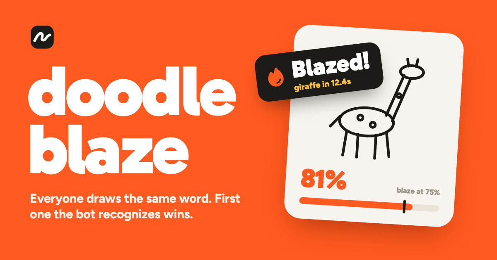

# Doodleblaze



A multiplayer drawing race. Everyone draws the same word at the same time while Drishti, an AI judge, watches every canvas. The first drawing Drishti recognizes (past 75%) wins the round.

Live at **https://doodleblaze.bimsina.dev**. Runs entirely on Cloudflare.

## Built with

- [Cloudflare Workers](https://developers.cloudflare.com/workers/) with [TanStack Start](https://tanstack.com/start) (React, SSR)
- [Durable Objects](https://developers.cloudflare.com/durable-objects/) for rooms: WebSockets, alarms, SQLite-backed state
- [Workers AI](https://developers.cloudflare.com/workers-ai/) running [Clef](https://developers.cloudflare.com/workers-ai/models/clef/), Cloudflare's decision model, as the judge
- [Workers Builds](https://developers.cloudflare.com/workers/ci-cd/builds/) for deploys from GitHub
- Tailwind CSS v4

## How it works

- **Worker** (`src/server.ts`): TanStack Start app plus a small API: `POST /api/rooms` creates a room, `/api/rooms/:code/ws` joins it.
- **Room Durable Object** (`src/server/room.ts`): one per room code. Holds the game state, the WebSocket connections, the phase timers (alarms), and the judging loop.
- **Strokes, not images.** Clients stream pen strokes; the room rasterizes them server-side into a 256×256 grayscale PNG (`src/server/raster.ts`). Nobody can upload a photo, and messages stay tiny.
- **Drishti** (`src/server/judge.ts`): Cloudflare's [Clef](https://developers.cloudflare.com/workers-ai/models/clef/) decision model, on Workers AI in production (or on a local Ollama in dev, see below). Each check asks one `choice` question per drawing: the word, three look-alike distractors, "something else", "scribble" and "written words". The meter is the word's probability, sharpened with temperature 0.7. Writing the word scores 0 because "written words" wins.
  - Changed canvases are judged at most every 1.5 s, and only once the pen lifts (or a stroke runs past 1.5 s). Up to 4 drawings go in one Clef request.
  - Winners are ordered by when their strokes arrived, not by when Clef answered.
  - Reveal cards reuse the last live check for free ("Definitely a cat", "70% sure this is a fox"). Only drawings filed under "something else" get one more look, against 40 random words, which produces the "8% sure this is a boomerang" verdicts.
- **The host's own words.** In the lobby the host can write a pack of 5 to 100 words. The room keeps the list; other players only get the count. A word that's also in a built-in pack (409 words across 14 themed packs) keeps its hand-picked look-alikes. Any other word uses three of the host's other words as its look-alikes (they tend to share a theme), topped up from the built-in list.

### What a check costs

Measured on the lab doodles with `clef` at $0.24 per million input tokens:

| Request                            | Input tokens | Cost     |
| ---------------------------------- | ------------ | -------- |
| 1 drawing                          | 290          | $0.00007 |
| 4 drawings, batched                | 969          | $0.00023 |
| Reveal guess against 40 words      | 897          | $0.00022 |
| (before trimming) 4 drawings       | 1,372        | $0.00033 |
| (before trimming) guess, 150 words | 3,370        | $0.00081 |

A 256×256 image is 67 tokens; the rest is the question. Workers AI's free 10,000 neurons a day cover about 2,000 single-drawing checks, and a 2-player game costs roughly 2 cents.

## Cost and abuse guards

The demo runs real, billed inference for anyone who opens it, so every Clef call passes a few guards:

| Guard                    | Where                            | What it does                                                                                                                                                                                                                                                                                                                                                                                                                                                                                                                                                                                           |
| ------------------------ | -------------------------------- | ------------------------------------------------------------------------------------------------------------------------------------------------------------------------------------------------------------------------------------------------------------------------------------------------------------------------------------------------------------------------------------------------------------------------------------------------------------------------------------------------------------------------------------------------------------------------------------------------------ |
| AI Gateway `doodleblaze` | `src/server/judge.ts`, dashboard | Every Clef call goes through the gateway, tagged with `room`, `kind` (`judge` or `verdict`) and `drawings` metadata. Its analytics show requests, tokens and cost per day; logs can be filtered by room. It also has a hard 300 requests/min sliding rate limit and a $1/day spend limit as last-resort backstops.                                                                                                                                                                                                                                                                                     |
| Judge budget             | `src/server/budget.ts`           | One `JudgeBudget` Durable Object that every room asks before calling Clef. A token bucket allows `JUDGE_PER_MINUTE` (240) requests a minute across all rooms, with bursts of 20, under Workers AI's 300/min account limit. It also sets the pace: if every room judging every 1.5 s would want 2× the budget, every room judges every 3 s (up to 8 s). Busy rooms slow down instead of failing. Canvases held back go first on the next tick, and a blaze only wins once everything drawn before it has been judged. The last look at time-up and the reveal verdicts are always granted, but counted. |
| Daily cap                | `src/server/budget.ts`           | `JUDGE_PER_DAY` (3,000) Clef requests per UTC day, at most about $0.70. Past it, new games pause until midnight UTC; games already running finish.                                                                                                                                                                                                                                                                                                                                                                                                                                                     |
| Pause switch             | KV namespace `FLAGS`             | Set `paused` to pause new games by hand, no deploy needed. Like the daily cap, room creation answers with "Drishti is resting its eyes" and the lobby's start button shows the same note.                                                                                                                                                                                                                                                                                                                                                                                                              |
| Room creation limit      | `src/server.ts`                  | 5 rooms a minute per IP (Workers Rate Limiting binding, counted per Cloudflare location).                                                                                                                                                                                                                                                                                                                                                                                                                                                                                                              |

If the budget Durable Object can't be reached, rooms keep judging at a 2 s pace and the gateway's limits still apply.

```bash
# Pause new games (add --ttl 86400 to pause for a day); takes up to a minute to reach every location
npx wrangler kv key put paused 1 --binding FLAGS --remote
# Resume
npx wrangler kv key delete paused --binding FLAGS --remote
```

To check the guards, run bots against a server (each judgement is real inference, a few cents per run):

```bash
node scripts/guard-check.mjs create https://doodleblaze.bimsina.dev     # 6th room in a minute gets a 429
node scripts/guard-check.mjs play https://doodleblaze.bimsina.dev       # one full room plays a round
node scripts/guard-check.mjs load https://doodleblaze.bimsina.dev 3 40  # 3 full rooms at once: judging slows to fit the budget
```

Locally, put lower limits in `.env.local` (for example `JUDGE_PER_MINUTE=30` and `JUDGE_PER_DAY=60`) to watch the pace widen and the daily cap pause new games. With `LAB_ENABLED=1`, `GET /api/lab/budget` shows today's count and the current pace.

## Develop

```bash
pnpm install
pnpm dev
```

Copy `.env.example` to `.env.local`. Its `JUDGE_MODE=mock` makes Drishti free locally: no Clef calls, and meters climb with how much you've drawn (plus some noise), so rounds can still be won. Set `JUDGE_MODE=live` and restart `pnpm dev` to use the real judge, from the provider `CLEF_PROVIDER` names:

| `CLEF_PROVIDER` | Where Clef runs                                                                                                     | Cost   |
| --------------- | ------------------------------------------------------------------------------------------------------------------- | ------ |
| `ollama`        | Any [System One](https://ollama.com/library/clef) endpoint at `CLEF_URL` (`/v1/systemone`), by default a local Ollama | Free   |
| `cloudflare`    | Workers AI through the AI Gateway. Always remote, even in dev, so it needs `wrangler login`                         | Billed |

Production uses `live` and `cloudflare` from `wrangler.jsonc`; `.env.example` defaults to `ollama`, so switching to live mode locally never spends money by accident. `CLEF_API_KEY` is sent as a bearer token, for a hosted System One endpoint that wants one.

### Local Clef

```bash
ollama pull clef   # about 18 GB; needs roughly 20 GB of free memory to run
```

Then set `JUDGE_MODE=live` and `CLEF_PROVIDER=ollama` in `.env.local` and restart `pnpm dev`. It counts tokens the same way as Workers AI (290 for one drawing), but it may not be the exact same build, so treat local scores as a close guide rather than a promise. On an M2 Max a check takes about 3 s for one drawing and 10 s for a batch of four (the first one loads the model, up to 2 minutes), so local meters move slower than in production. Ollama caps a choice question at 26 options, so reveal guesses use 26 random words instead of 40.

### Tuning the judge

With `LAB_ENABLED=1` in `.env.local`, the dev server exposes `POST /api/lab/judge`, and rooms accept a `word:<word>` pack to force the next prompt. Run synthetic doodles through it:

```bash
node scripts/judge-lab.mjs /tmp/lab '[{"word":"cat","drawings":["cat_2_ears","cat_4_whiskers","written_cat","scribble"],"verdict":true}]'
```

Prompt packs and distractors live in `src/shared/prompts.ts`; timings and scoring in `src/shared/protocol.ts`.

The share image (`public/og.png`) and app icons are rendered from `scripts/brand/*.html` with headless Chrome: `bash scripts/brand/render.sh`. Icons in the UI are [Phosphor](https://phosphoricons.com).

## Deploy

Pushing to `main` deploys through Workers Builds. The Worker is served only on the custom domain (`workers_dev` and preview URLs are off).
